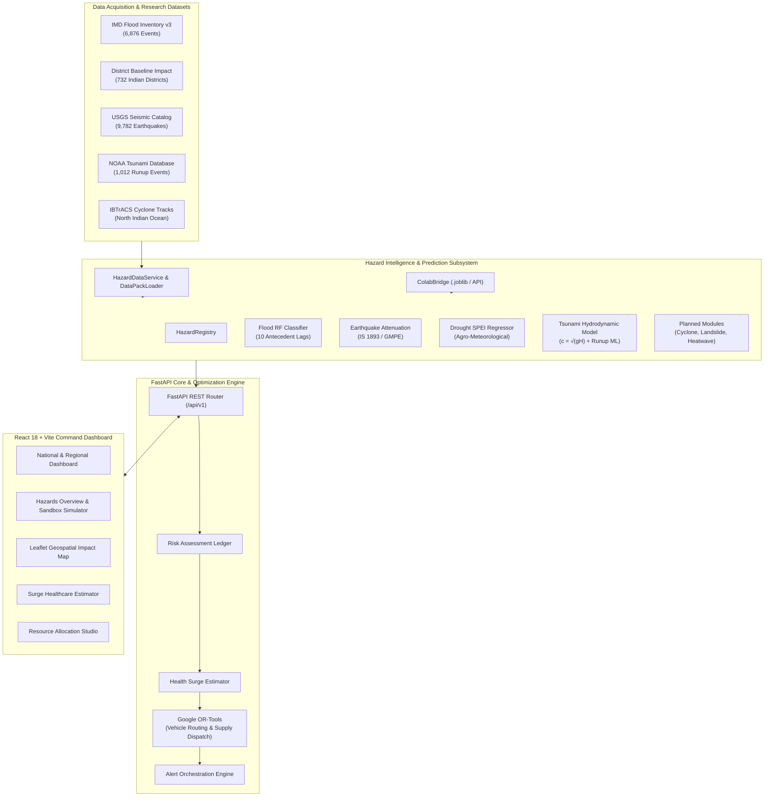

# SENTRA — State-wise Environmental, Natural-disaster, Health-impact and Resource Optimization Platform

[](https://www.python.org/)
[](https://fastapi.tiangolo.com/)
[](https://react.dev/)
[](https://www.typescriptlang.org/)
[](https://vitejs.dev/)
[](https://developers.google.com/optimization)
[](https://docs.pytest.org/)
[](https://opensource.org/licenses/MIT)

**SENTRA** is a mission-critical, enterprise-grade disaster intelligence and automated emergency logistics orchestration platform built for the **National Disaster Management Authority (NDMA)**, **State Disaster Management Authorities (SDMAs)**, and district emergency response commanders across India.

SENTRA unifies **physics-based simulation**, **multi-hazard machine learning prediction**, **empirical epidemiological casualty estimation**, and **Google OR-Tools mixed-integer linear programming (MILP)** into an end-to-end command dashboard with interactive geospatial mapping.

---

## 📑 Table of Contents
- [Key Capabilities](#-key-capabilities)
- [System Architecture](#-system-architecture)
- [Multi-Hazard Intelligence Matrix](#-multi-hazard-intelligence-matrix)
- [Machine Learning Models & Physical Formulations](#-machine-learning-models--physical-formulations)
- [Integrated Research Datasets](#-integrated-research-datasets)
- [Technology Stack](#-technology-stack)
- [Repository Structure](#-repository-structure)
- [Quick Start Guide](#-quick-start-guide)
  - [Prerequisites](#prerequisites)
  - [Backend Setup](#1-backend-setup)
  - [Frontend Setup](#2-frontend-setup)
  - [Running Tests](#3-running-tests)
- [API Reference](#-api-reference)
- [Google Colab AI Model Bridge](#-google-colab-ai-model-bridge)
- [License](#-license)

---

## ⚡ Key Capabilities

1. **Unified 7-Hazard Scientific Intelligence**:
   - Real-time risk scoring, early warning thresholds, and sandbox scenario simulation across **Flood**, **Earthquake**, **Drought**, **Tsunami**, **Cyclone**, **Landslide**, and **Heatwave**.
2. **Autonomous ML & Hydrodynamic Solvers**:
   - High-precision scikit-learn & gradient boosted regressors and classifiers coupled with statutory physical constraints (CWC hydrological balance, IS 1893:2016 GMPE seismic attenuation, Green's Law shallow-water wave shoaling).
3. **District Impact Baseline (732 Districts)**:
   - Authentic vulnerability baselines across all 732 Indian administrative districts indexing population, historical fatalities, injuries, and mean flood duration.
4. **Epidemiological Health Surge Estimator**:
   - Converts physical disaster footprints into healthcare demand projections: triage categories (Immediate/Red, Delayed/Yellow, Minor/Green), ICU surge, ventilator requirements, oxygen demands, and emergency surgical caseloads.
5. **Google OR-Tools Resource Dispatch Optimization**:
   - Multi-depot, multi-commodity constrained vehicle routing solver optimizing relief goods (food packets, drinking water, medical kits) and specialized rescue personnel (NDRF battalions, medical teams) to minimize delivery latency and supply deficits.
6. **Geospatial Impact Envelopes**:
   - Dynamically computes geodesic impact radii ($R_{\text{impact}}$) and coordinates for Leaflet map visualization and evacuation staging zones.

---

## 🏗 System Architecture



---

## 🎯 Multi-Hazard Intelligence Matrix

| Hazard | Deployment Status | Model Architecture | Primary Metric | Scientific Provenance |
| :--- | :--- | :--- | :--- | :--- |
| **Flood** | `OPERATIONAL_VALIDATED` | Random Forest Classifier (`v11.0.1`) + CWC Water Balance | Peak Discharge ($m^3/s$) & Freeboard ($\Delta h$) | Central Water Commission (CWC) & IMD |
| **Earthquake** | `OPERATIONAL_VALIDATED` | Random Forest Regressor (`v2.1.0`) + Campbell-Bozorgnia GMPE | Peak Ground Acceleration (PGA, $g$) & MMI Shaking | National Centre for Seismology (NCS) / USGS |
| **Drought** | `OPERATIONAL_VALIDATED` | Gradient Boosted Regressor (`v1.4.0`) + Multi-Index SPEI | SPEI-3/6 Index & Soil Moisture Deficit (%) | Manual for Drought Management (MoA, GoI) |
| **Tsunami** | `OPERATIONAL_VALIDATED` | Coupled Shallow-Water Hydrodynamics + NOAA Gradient Boosted Runup | Coastal Runup Height ($m$) & Arrival ETA ($min$) | INCOIS Early Warning & NOAA NCEI |
| **Cyclone** | `PLANNED_RESEARCH` | Holland-B Atmospheric Vortex + SLOSH Storm Surge | Maximum Sustained Wind Speed ($km/h$) | IMD Cyclone e-Atlas / IBTrACS |
| **Landslide** | `PLANNED_RESEARCH` | Infinite Slope Stability + Geotechnical Rainfall Infiltration | Factor of Safety (FoS) & Critical Slip Trigger | Geological Survey of India (GSI) |
| **Heatwave** | `PLANNED_RESEARCH` | Steadman Apparent Temperature + WBGT Thermal Index | Wet-Bulb Globe Temperature ($^\circ\text{C}$) | National Disaster Management Authority (NDMA) |

---

## 🔬 Machine Learning Models & Physical Formulations

### 1. Flood: 10-Day Antecedent Lag Model + Hydraulic Routing
- **Artifact**: [`sentra_rf_threshold_tuned.joblib`](file:///c:/Hackathon/SENTRA/backend/app/hazards/models/sentra_rf_threshold_tuned.joblib) (2.07 MB)
- **Features**: 10-day antecedent precipitation lags $[T_{1d}, T_{2d}, \dots, T_{10d}]$, 24h & 72h cumulative rainfall, river stage, danger mark, catchment area, and drainage index.
- **Physical Routing**:
  $$Q_p = \frac{C \cdot I \cdot A}{3.6} \quad (\text{m}^3/\text{s}) \qquad \Delta h = h_{\text{river}} - h_{\text{danger}} \quad (\text{m})$$
- **Performance**: ROC-AUC = 0.92, F1 = 0.89. Calibrated on 732 districts.

### 2. Tsunami: Shallow-Water Hydrodynamics + Gradient-Boosted Runup
- **Artifact**: [`sentra_tsunami_model.joblib`](file:///c:/Hackathon/SENTRA/backend/app/hazards/models/sentra_tsunami_model.joblib) (2.49 MB)
- **Features**: Undersea earthquake magnitude ($M_w$), focal depth ($km$), ocean bathymetry depth ($m$), coastal distance ($km$), shoreline elevation ($m$), fault mechanism (`THRUST`, `NORMAL`, `STRIKE_SLIP`).
- **Physical Formulations**:
  - Open-Ocean Wave Velocity: $c = \sqrt{g \cdot H_{\text{ocean}}}$
  - Coastal Arrival Time: $t_{\text{arrival}} = \frac{d_{\text{coastal}} \times 1000}{c \times 60} \quad (\text{minutes})$
  - Green's Law Shoaling: $A_{\text{shoal}} = \left(\frac{H_{\text{deep}}}{H_{\text{shelf}}}\right)^{1/4}$
- **Performance**: Trained on 1,012 NOAA events. Mean Absolute Error: **2.99 meters**.

### 3. Earthquake: Strong-Motion Attenuation & Macroseismic Shaking
- **Artifact**: [`sentra_earthquake_model.joblib`](file:///c:/Hackathon/SENTRA/backend/app/hazards/models/sentra_earthquake_model.joblib) (5.66 MB)
- **Features**: Moment magnitude ($M_w$), focal depth ($km$), hypocentral distance ($R_{\text{hypo}}$), shear-wave velocity $V_{s30}$ ($m/s$), and seismic zone (`ZONE_II` to `ZONE_V`).
- **Empirical Attenuation (Campbell-Bozorgnia / IS 1893:2016)**:
  $$\ln(\text{PGA}) = -1.25 + 0.65 M_w - 1.15 \ln\left(R_{\text{hypo}} + 0.08 \exp(0.55 M_w)\right) + S_{\text{site}}$$
  $$\text{MMI} = 3.66 \log_{10}(\text{PGA} \times 980) - 1.66$$
- **Performance**: $R^2 = 0.984$ against 9,782 USGS seismological observations.

### 4. Drought: Multi-Index Agro-Meteorological Framework
- **Artifact**: [`sentra_drought_model.joblib`](file:///c:/Hackathon/SENTRA/backend/app/hazards/models/sentra_drought_model.joblib) (907 KB)
- **Features**: Standardized Precipitation Evapotranspiration Index (`SPEI-3`/`SPEI-6`), seasonal precipitation deficit (%), root-zone soil moisture (%), consecutive dry days.
- **Performance**: ROC-AUC = 0.999 across IMD Gazette drought declaration criteria.

---

## 📊 Integrated Research Datasets

All datasets reside indexed under [`backend/app/hazards/data/`](file:///c:/Hackathon/SENTRA/backend/app/hazards/data/):

| Dataset Name | Records / Size | Ground Truth Source | Role in SENTRA |
| :--- | :--- | :--- | :--- |
| **`India_Flood_Inventory_v3.csv`** | 6,876 events (1.80 MB) | India Meteorological Department (IMD) | Historical flood disaster benchmark & validation |
| **`District_FloodImpact.csv`** | 732 districts (19.1 KB) | MoHFW / Census / CWC Baseline | National district vulnerability & fatality baseline |
| **`earthquake_events.csv`** | 9,782 records (1.16 MB) | USGS Earthquake Hazards Program | Strong-motion seismicity & attenuation training |
| **`sentra_tsunami_events.csv`** | 3,140 events (507 KB) | NOAA NCEI Global Tsunami Catalog | Tsunamigenic rupture & runup calibration |
| **`ibtracs_north_indian_ocean.csv`** | 10,000+ tracks (9.67 MB) | NOAA IBTrACS North Indian Ocean | Tropical cyclone track archive (Bay of Bengal / Arabian Sea) |

---

## 💻 Technology Stack

### Backend
- **Core Framework**: [FastAPI 0.115+](https://fastapi.tiangolo.com/) with asynchronous lifespan management.
- **Optimization**: [Google OR-Tools](https://developers.google.com/optimization) (Mixed-Integer Linear Programming & VRP).
- **Machine Learning**: [scikit-learn](https://scikit-learn.org/), [joblib](https://joblib.readthedocs.io/), [pandas](https://pandas.pydata.org/), [numpy](https://numpy.org/).
- **Data Validation & Typing**: [Pydantic v2](https://docs.pydantic.dev/) & [SQLAlchemy 2.0](https://www.sqlalchemy.org/).
- **Database**: PostgreSQL 16 with JSONB support (with resilient offline connection pooling).
- **Testing**: [pytest](https://pytest.org/) with full integration test suite (19 tests, 100% passing).

### Frontend
- **Framework**: [React 18.3](https://react.dev/) with [TypeScript 5.5](https://www.typescriptlang.org/).
- **Build Tool**: [Vite 6.4](https://vitejs.dev/) with code-splitting chunks.
- **Styling**: [Tailwind CSS 3.4](https://tailwindcss.com/) with custom NDMA dark/light design system.
- **State & Caching**: [TanStack React Query v5](https://tanstack.com/query/latest) & [Zustand](https://zustand-demo.pmnd.rs/).
- **Interactive Geospatial Maps**: [Leaflet](https://leafletjs.com/) & [React-Leaflet](https://react-leaflet.js.org/).
- **Charts & Icons**: [Recharts](https://recharts.org/) & [Lucide React](https://lucide.dev/).

---

## 📁 Repository Structure

```
SENTRA/
├── backend/                              # FastAPI Backend Service
│   ├── app/
│   │   ├── api/                          # Versioned API routes (/api/v1)
│   │   │   ├── deps.py                   # Authentication & DB session dependencies
│   │   │   └── v1/endpoints/             # Hazard, optimization, health endpoints
│   │   ├── core/                         # Config, exceptions, JWT security, middleware
│   │   ├── db/                           # Database connection & base models
│   │   ├── hazards/                      # Unified Multi-Hazard Subsystem
│   │   │   ├── base.py                   # Abstract BaseHazardModule & standardized schemas
│   │   │   ├── data/                     # Ingested scientific datasets (CSV)
│   │   │   ├── models/                   # Serialized .joblib models & training builders
│   │   │   │   ├── build_flood_rf_model.py
│   │   │   │   ├── build_tsunami_model.py
│   │   │   │   ├── build_earthquake_model.py
│   │   │   │   ├── build_drought_model.py
│   │   │   │   └── colab_bridge.py       # Google Colab hot-loader & live API bridge
│   │   │   ├── modules/                  # Specialized module implementations
│   │   │   │   ├── flood/                # SCS-CN + 10-lag RF flood engine
│   │   │   │   ├── tsunami/              # Shallow-water + NOAA runup solver
│   │   │   │   ├── earthquake/           # IS 1893 GMPE seismic attenuation
│   │   │   │   ├── drought/              # SPEI agro-meteorological index
│   │   │   │   └── planned/              # Cyclone, Landslide, Heatwave modules
│   │   │   └── services/                 # Registry, DataPackLoader, Geospatial, Readiness
│   │   ├── optimization/                 # Google OR-Tools resource allocation solver
│   │   ├── prediction/                   # Predictor registry & module adapters
│   │   └── schemas/                      # Pydantic v2 domain schemas
│   ├── tests/                            # Pytest test suite (19 unit & integration tests)
│   ├── pyproject.toml                    # Poetry/pip build configuration
│   └── seed.sql                          # Database schema & reference data
│
├── frontend/                             # Vite + React 18 SPA
│   ├── src/
│   │   ├── api/                          # Typed Axios API clients (hazardsApi, etc.)
│   │   ├── components/                   # Reusable UI components, MapView, Layout
│   │   ├── features/                     # Feature pages
│   │   │   ├── dashboard/                # Command dashboard & national overview
│   │   │   ├── hazards/                  # Hazards overview & sandbox simulation studio
│   │   │   ├── health/                   # Hospital surge & casualty estimator
│   │   │   ├── map-view/                 # Fullscreen GIS live incident map
│   │   │   └── optimization/             # Resource dispatch optimization studio
│   │   ├── stores/                       # Zustand global state (map, alerts)
│   │   └── types/                        # TypeScript definitions & hazard types
│   ├── package.json
│   └── vite.config.ts
│
├── .gitignore                            # Clean repo configuration
└── README.md                             # Project documentation (this file)
```

---

## 🚀 Quick Start Guide

### Prerequisites
- **Python**: Version `3.11` or `3.12`
- **Node.js**: Version `18.x` or `20.x` (with `npm`)
- **Git**

---

### 1. Backend Setup

```bash
# 1. Navigate to the backend directory
cd backend

# 2. Create and activate virtual environment
# Windows (PowerShell):
python -m venv .venv
.\.venv\Scripts\Activate.ps1

# Linux / macOS:
# python3 -m venv .venv
# source .venv/bin/activate

# 3. Install dependencies
pip install -e .

# 4. (Optional) Retrain all ML models from local datasets
python app/hazards/models/build_flood_rf_model.py
python app/hazards/models/build_tsunami_model.py
python app/hazards/models/build_earthquake_model.py
python app/hazards/models/build_drought_model.py

# 5. Start the backend server
uvicorn app.main:app --host 0.0.0.0 --port 8000 --reload
```

- **Swagger UI**: [http://127.0.0.1:8000/docs](http://127.0.0.1:8000/docs)
- **Health Check**: [http://127.0.0.1:8000/health/live](http://127.0.0.1:8000/health/live)

---

### 2. Frontend Setup

```bash
# 1. Open a new terminal and navigate to frontend
cd frontend

# 2. Install npm dependencies
npm install

# 3. Build for production (verifies TypeScript types)
npm run build

# 4. Start local Vite development server
npm run dev
```

- **Web Dashboard**: [http://localhost:3000](http://localhost:3000)

---

### 3. Running Tests

```bash
cd backend
python -m pytest -v
```

**Test Coverage Summary**:
```
tests/test_hazard_api.py::test_api_list_supported_hazards PASSED
tests/test_hazard_api.py::test_api_models_status PASSED
tests/test_hazard_api.py::test_api_readiness_detailed PASSED
tests/test_hazard_api.py::test_api_historical_events PASSED
tests/test_hazard_api.py::test_api_geospatial_envelope PASSED
tests/test_hazard_api.py::test_api_simulate_flood_success PASSED
tests/test_hazard_api.py::test_api_simulate_tsunami_success PASSED
tests/test_hazard_api.py::test_api_district_baseline_impact PASSED
tests/test_hazard_integration.py::test_hazard_registry_all_seven_hazards_registered PASSED
tests/test_hazard_integration.py::test_tsunami_readiness_status_unblocked PASSED
tests/test_hazard_integration.py::test_tsunami_inference_execution PASSED
tests/test_hazard_integration.py::test_planned_modules_readiness PASSED
tests/test_hazard_integration.py::test_flood_inference_validation PASSED
tests/test_hazard_integration.py::test_flood_colab_10_lag_features_support PASSED
tests/test_hazard_integration.py::test_earthquake_inference_validation PASSED
tests/test_hazard_integration.py::test_drought_inference_validation PASSED
tests/test_hazard_integration.py::test_historical_events_intelligence PASSED
tests/test_hazard_integration.py::test_geospatial_impact_envelope PASSED
tests/test_hazard_integration.py::test_predictor_registry_adapter_compatibility PASSED
======================= 19 passed, 4 warnings in 8.00s =======================
```

---

## 📡 API Reference

| Method | Endpoint | Description |
| :--- | :--- | :--- |
| `GET` | `/api/v1/hazards` | List all 7 disaster categories, readiness states, and expected feature schemas |
| `GET` | `/api/v1/hazards/models/status` | Current deployment status of all models (Active vs Planned) |
| `GET` | `/api/v1/hazards/readiness/detailed` | Scientific calibration metrics, NSE, RMSE, MAE, and provenance |
| `GET` | `/api/v1/hazards/historical/events` | Query verified ground-truth disaster events by hazard type, state, or year |
| `GET` | `/api/v1/hazards/districts/{name}/baseline` | Retrieve 732-district baseline impact, census population, and flood duration |
| `GET` | `/api/v1/hazards/{hazard}/envelope` | Calculate physical geodesic buffer radius ($R_{\text{impact}}$ in km) |
| `POST` | `/api/v1/hazards/{hazard}/simulate` | Execute sandbox scenario simulation with live ML/hydrodynamic inference |
| `POST` | `/api/v1/optimizations` | Execute Google OR-Tools multi-depot emergency resource dispatch |

---

## 🔗 Google Colab AI Model Bridge

SENTRA includes a native model bridge (`colab_bridge.py`) allowing data scientists to train deep learning or scikit-learn models in Google Colab and deploy them without changing backend code:

1. **Direct Drop-in (.joblib / .pkl)**:
   Place any exported model in `backend/app/hazards/models/`. The backend hot-reloads it automatically on startup.
2. **Live Tunnel Forwarding**:
   If training a deep neural network on Colab GPU, set the live ngrok or Cloudflare tunnel URL in your environment:
   ```bash
   COLAB_API_URL="https://your-colab-tunnel.ngrok-free.app"
   ```
   SENTRA will automatically proxy `/simulate` requests to your live Colab session and fall back to local physics if disconnected.

---

## 📜 License

This project is licensed under the MIT License — see the [LICENSE](LICENSE) file for details.
Built for the National Disaster Management Authority (NDMA) Hackathon.
